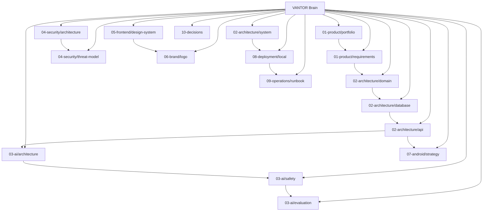

# VANTOR documentation map

<!-- vantor-brain-link -->
> You are in the 🧠 **VANTOR Brain** - mirror index: [Docs index](README.md).

Every document in the documentation tree links back here, and this page links
to every document. The prose index is [`docs/README.md`](README.md); the
repository root is [`../README.md`](../README.md).

## How to read VANTOR in five minutes

1. What it is and how to run it → [`../README.md`](../README.md)
2. What it does → [`01-product/portfolio.md`](01-product/portfolio.md)
3. How it is put together → [`02-architecture/system.md`](02-architecture/system.md)
4. How it is secured → [`04-security/architecture.md`](04-security/architecture.md)
5. Shared vocabulary → [`glossary.md`](glossary.md)

## Knowledge graph

## Every document

| # | Document | What it answers |
|---|---|---|
| 0 | [`../README.md`](../README.md) | What VANTOR is, quickstart, architecture, limitations |
| 0 | [`00-plan/ROADMAP.md`](00-plan/ROADMAP.md) | Build phases and what remains in each |
| 1 | [`01-product/requirements.md`](01-product/requirements.md) | Modules, the procurement graph, non-negotiables |
| 1 | [`01-product/portfolio.md`](01-product/portfolio.md) | The capability map and where each capability lives |
| 2 | [`02-architecture/system.md`](02-architecture/system.md) | Modular monolith, deployment topology |
| 2 | [`02-architecture/domain.md`](02-architecture/domain.md) | The domain model and its entities |
| 2 | [`02-architecture/database.md`](02-architecture/database.md) | PostgreSQL, pgvector, row-level security |
| 2 | [`02-architecture/api.md`](02-architecture/api.md) + [`../api/openapi.json`](../api/openapi.json) | REST conventions, typed AI tools, the generated contract |
| 3 | [`03-ai/architecture.md`](03-ai/architecture.md) | The gateway, evidence contracts, human review |
| 3 | [`03-ai/safety.md`](03-ai/safety.md) | Prompt-injection defences and guardrails |
| 3 | [`03-ai/evaluation.md`](03-ai/evaluation.md) | How AI behaviour is evaluated |
| 4 | [`04-security/architecture.md`](04-security/architecture.md) | Authentication, authorisation, tenancy, audit |
| 4 | [`04-security/threat-model.md`](04-security/threat-model.md) | Threats, mitigations, residual risk |
| 5 | [`05-frontend/design-system.md`](05-frontend/design-system.md) | Tokens, palettes, components, accessibility |
| 6 | [`06-brand/logo.md`](06-brand/logo.md) + [`../assets/brand/`](../assets/brand/) | Brand assets and usage |
| 7 | [`07-android/strategy.md`](07-android/strategy.md) | The Android client strategy |
| 8 | [`08-deployment/local.md`](08-deployment/local.md) + [`../docker-compose.yml`](../docker-compose.yml) | Every environment variable, the local stack |
| 9 | [`09-operations/runbook.md`](09-operations/runbook.md) | Health checks, backup, incident response |
| 10 | [`10-decisions/README.md`](10-decisions/README.md) | The architecture decision records |
| X | [`glossary.md`](glossary.md) | The shared vocabulary |

## Reading trails

- **New developer:** Brain → portfolio → glossary → system → database → api → deployment → runbook
- **New auditor:** Brain → threat model → security architecture → domain model → runbook
- **New AI engineer:** Brain → portfolio → ai/architecture → safety → evaluation → api → domain
- **New designer:** Brain → portfolio → brand → design system → android strategy
- **New operator:** Brain → system → deployment → runbook → ADR-001, ADR-002, ADR-005

## Maintenance rule

A new `.md` added under `docs/` must:

1. add a row to the table above,
2. link back to `BRAIN.md`,
3. appear in `docs/README.md` and in the `mkdocs.yml` navigation.

`python scripts/verify_doc_links.py` enforces all three, and the CI docs gate
runs it.
